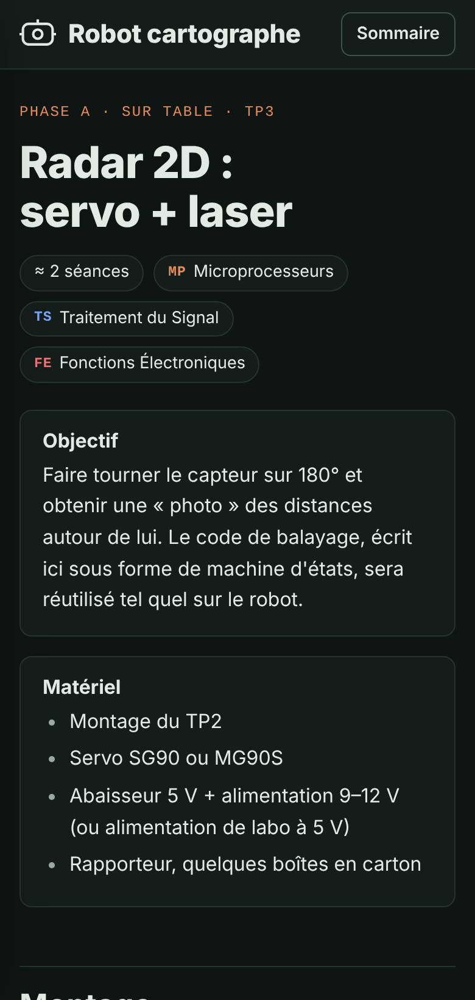
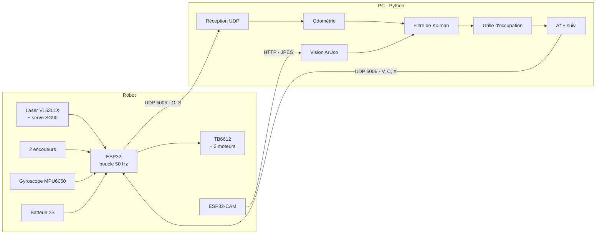
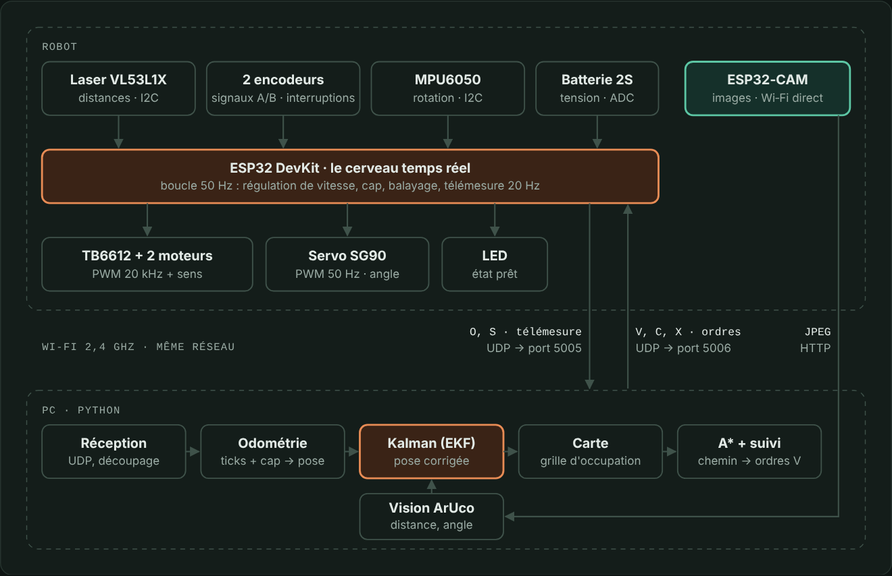

<div align="center">

# Robot Cartographe SLAM

**Un robot qui dessine la carte d'une pièce, se recale grâce à la vision, puis s'y déplace seul.**

Projet de Travaux Avant Projet · L3 Électronique · USTHB


</div>

---

## Sommaire

- [Le projet en bref](#le-projet-en-bref)
- [Ouvrir le manuel](#ouvrir-le-manuel)
- [Architecture](#architecture)
- [Le parcours : 14 TPs](#le-parcours--14-tps)
- [Lien avec les modules du semestre](#lien-avec-les-modules-du-semestre)
- [Matériel](#matériel)
- [Contenu du dépôt](#contenu-du-dépôt)
- [Démarrage rapide du code](#démarrage-rapide-du-code)
- [Protocole de communication](#protocole-de-communication)
- [État du projet](#état-du-projet)

---

## Le projet en bref

Le robot réalise une forme simple de **SLAM** (localisation et cartographie simultanées) en combinant deux capteurs complémentaires :

| Étape | Ce que fait le robot | Comment |
| :---: | --- | --- |
| **1** | **Balayer** | Un capteur laser VL53L1X sur un servomoteur mesure les distances sur 180°, puis le robot fait demi-tour pour couvrir 360°. |
| **2** | **Cartographier** | Le PC construit une grille d'occupation (libre / mur / inconnu) affichée en direct. |
| **3** | **Se recaler** | Une ESP32‑CAM lit des marqueurs ArUco collés aux murs ; un filtre de Kalman étendu corrige la dérive de l'odométrie. |
| **4** | **Naviguer** | On clique plusieurs points sur la carte ; le robot calcule son chemin avec A* et va de l'un à l'autre. |

Le projet avance en **deux phases** : chaque brique est d'abord validée seule sur une plaque d'essai (phase A), puis tout est assemblé sur la voiture (phase B).

---

## Ouvrir le manuel

Tout le manuel tient dans un seul fichier : **[`index.html`](index.html)**.

1. Télécharger le dépôt : bouton **Code → Download ZIP**, ou `git clone`.
2. Ouvrir `index.html` dans un navigateur (Chrome, Firefox, Edge).

Le manuel fonctionne sans serveur et presque entièrement hors ligne (seules les polices et la coloration du code viennent d'internet). Les cases cochées dans les checklists sont mémorisées dans le navigateur.

<div align="center">
 
</div>

---

## Architecture

L'ESP32 fait uniquement ce qui exige du **temps réel** ; tout ce qui demande de la mémoire ou du calcul tourne sur le **PC**. Ils ne sont reliés que par le Wi‑Fi.



<details>
<summary><strong>Voir le schéma d'ensemble et le brochage du manuel</strong></summary>
<br>

<br><br>

</details>

### Brochage de l'ESP32

| GPIO | Fonction | Relié à |
| :---: | --- | --- |
| `21` / `22` | SDA / SCL (I2C) | VL53L1X (0x29), MPU6050 (0x68) |
| `13` | PWM 50 Hz | Servo SG90 |
| `25` `26` `27` | PWMA, AIN1, AIN2 | TB6612, moteur gauche |
| `18` `16` `17` | PWMB, BIN1, BIN2 | TB6612, moteur droit |
| `23` | STBY | TB6612 |
| `34` `35` / `36` `39` | Encodeurs A, B | Encodeurs gauche / droit (tirage 10 kΩ vers 3,3 V) |
| `33` | ADC1 | Pont diviseur 100 kΩ / 33 kΩ de la batterie |
| `2` | LED | LED d'état intégrée |

---

## Le parcours : 14 TPs

<table>
<tr>
<th width="50%">🟧 Phase A · sur table</th>
<th width="50%">🟩 Phase B · sur la voiture</th>
</tr>
<tr valign="top">
<td>

| TP | Sujet |
| :---: | --- |
| 0 | Installer l'environnement |
| 1 | ESP32 : GPIO, PWM, interruptions, timers |
| 2 | Capteur laser VL53L1X et filtre médian |
| 3 | Radar 2D : servo + laser |
| 4 | Envoyer le radar au PC en Wi‑Fi (UDP) |
| 5 | Caméra, calibration et marqueurs ArUco |
| 6 | Gyroscope MPU6050 : mesurer le cap |
| 7 | Moteurs, encodeurs et régulateur PI |

</td>
<td>

| TP | Sujet |
| :---: | --- |
| 8 | Montage mécanique et alimentation |
| 9 | Firmware complet, odométrie, pilotage clavier |
| 10 | Cartographie par grille d'occupation |
| 11 | Fusion : filtre de Kalman + ArUco |
| 12 | Navigation A* vers plusieurs points |
| 13 | Intégration, tests et soutenance |

</td>
</tr>
</table>

Chaque TP du manuel contient : **objectif**, **matériel**, **câblage**, **étapes**, **code complet**, **critères de validation chiffrés**, **pièges fréquents** et une **checklist**.

---

## Lien avec les modules du semestre

| Module | Dans le projet | TPs |
| --- | --- | :---: |
| **Fonctions Électroniques** | Pont en H, encodeurs, régulation 5 V, pont diviseur, modèle du moteur | 7, 8 |
| **Traitement du Signal** | Filtre médian, intégration du gyroscope, traitement d'image, filtre de Kalman | 2, 3, 5, 6, 11 |
| **Systèmes Microprocesseurs** | PWM (LEDC), interruptions, timers, I2C, ADC, ordonnancement non bloquant | 1, 3, 7, 9 |
| **Réseaux Informatiques Locaux** | IP, sockets UDP, protocole applicatif, latence et pertes, HTTP, Wireshark | 4, 5, 9 |

---

## Matériel

| Composant | Rôle |
| --- | --- |
| ESP32 DevKit V1 (×2, dont une de secours) | Cerveau du robot, Wi‑Fi |
| Capteur laser VL53L1X | Distances jusqu'à 4 m |
| Servo SG90 / MG90S | Balayage sur 180° |
| ESP32‑CAM AI‑Thinker + carte ESP32‑CAM‑MB | Images pour les marqueurs ArUco |
| MPU6050 (GY‑521) | Vitesse de rotation (cap) |
| TB6612FNG | Pont en H double |
| 2 motoréducteurs 6 V **avec encodeur** | Propulsion et odométrie |
| Châssis 2 roues + roue folle | Base mobile |
| 2 accus 18650 + support 2S + chargeur | Alimentation 7,4 V |
| Abaisseur DC‑DC 5 V / 3 A, fusible, interrupteur | Distribution de l'énergie |

**Budget : environ 100 €**, ESP32 de secours et accessoires compris. La liste détaillée, avec ce qu'il faut vérifier avant chaque achat, se trouve dans le manuel (chapitre *Matériel détaillé*).

---

## Contenu du dépôt

```text
Robot-Cartographe-Slam/
├── index.html                 le manuel complet (à ouvrir dans un navigateur)
├── firmware/
│   ├── tests/                 un croquis Arduino par TP de la phase A
│   │   ├── tp0_blink/   tp1_pwm/   tp2_scan_i2c/   tp2_laser/
│   │   └── tp3_radar/   tp4_radar_wifi/   tp6_cap/   tp7_banc_moteur/
│   └── robot_fw/              firmware final du robot (TP9 → TP13)
├── pc/
│   ├── requirements.txt
│   ├── tools/                 scripts de test : tracés, calibration, analyse
│   └── robot/                 application : odométrie, carte, EKF, A*, interface
├── mesures/                   courbes, CSV et photos pour le rapport
└── docs/captures/             captures d'écran du manuel
```

---

## Démarrage rapide du code

**Firmware (Arduino IDE 2)**

1. Ajouter les cartes ESP32 (Espressif, version **3.x**) et la bibliothèque **VL53L1X** de Pololu.
2. Ouvrir le dossier d'un TP dans `firmware/tests/`, choisir la carte *ESP32 Dev Module*, téléverser.
3. Pour le robot complet, renseigner le Wi‑Fi dans `firmware/robot_fw/comms.h` et la géométrie dans `config.h`.

**PC (Python 3.10+)**

```bash
python -m venv venv
source venv/bin/activate          # Windows : venv\Scripts\activate
pip install -r pc/requirements.txt

cd pc/robot
python teleop.py 192.168.43.50                                   # TP9 : pilotage au clavier
python app.py 192.168.43.50 http://192.168.43.51/capture         # TP12 : application finale
```

> Le réseau conseillé est le **partage de connexion d'un téléphone en 2,4 GHz** : PC, robot et caméra s'y connectent.

---

## Protocole de communication

Messages texte, un par datagramme UDP, champs séparés par des virgules.

| Sens | Message | Rôle |
| --- | --- | --- |
| Robot → PC (port 5005) | `O,seq,t_ms,ticksG,ticksD,cap_mdeg,avant_mm,vbat_mV` | Télémesure à 20 Hz |
| Robot → PC | `S,seq,angle0,pas,d0,…,d60` | Un balayage de 61 distances |
| PC → robot (port 5006) | `V,v_mm_s,w_mrad_s` | Consigne de vitesse (chien de garde à 500 ms) |
| PC → robot | `C` · `X` · `M,pwmG,pwmD` · `P,…` | Balayer · arrêter · commande directe · ping |

---

## État du projet

- [x] Manuel complet : matériel, schémas, modules, protocole, 14 TPs
- [x] Code ESP32 et Python de tous les TPs
- [ ] Phase A validée sur table
- [ ] Robot assemblé (phase B)
- [ ] Carte, fusion et navigation validées
- [ ] Rapport et soutenance

> **Note** : le code est fourni comme base de départ. Il a été vérifié (syntaxe du firmware, tests des modules Python sur données simulées) mais pas encore sur le matériel réel : des ajustements sont à prévoir pendant les TPs, et c'est le but des étapes de validation.

---

<div align="center">
<sub>Projet TAP · Licence 3 Électronique · Université des Sciences et de la Technologie Houari Boumediene</sub>
</div>
