<div align="center">


<br/>


<p>
  
  
  
</p>
<p>
  
  
  
  
  
</p>

<p>
  <a href="https://z-nadjib.github.io/Robot-Cartographe-Slam/"><b>▶ Ouvrir le manuel en ligne</b></a>
</p>

<p>
  <a href="#le-manuel"><b>Manuel</b></a> &nbsp;·&nbsp;
  <a href="#le-code--des-squelettes-à-compléter"><b>Code</b></a> &nbsp;·&nbsp;
  <a href="#installation"><b>Installation</b></a> &nbsp;·&nbsp;
  <a href="#utilisation"><b>Utilisation</b></a> &nbsp;·&nbsp;
  <a href="#le-parcours-en-14-tps"><b>TPs</b></a> &nbsp;·&nbsp;
  <a href="#architecture"><b>Architecture</b></a> &nbsp;·&nbsp;
  <a href="#protocole"><b>Protocole</b></a> &nbsp;·&nbsp;
  <a href="#matériel"><b>Matériel</b></a>
</p>

</div>

<br/>

**Robot Cartographe SLAM** est un projet de Travaux Avant Projet destiné à un groupe d'étudiants de L3 Électronique de l'USTHB. Les étudiants y construisent un petit robot à deux roues qui fait du **SLAM** simplifié, c'est-à-dire qu'il se localise et cartographie en même temps.

Le robot balaye la pièce avec un laser monté sur un servomoteur, et le PC en tire une **grille d'occupation**. Une caméra lit des **marqueurs ArUco** collés aux murs pour corriger la dérive de l'odométrie. On clique ensuite des points sur la carte, et le robot s'y rend seul grâce à **A\***.

Le dépôt contient le manuel des 14 TPs et le **squelette** de tout le code : le firmware de l'ESP32 et l'application Python du PC sont à écrire en suivant la description placée en tête de chaque fichier.

<p align="center">
  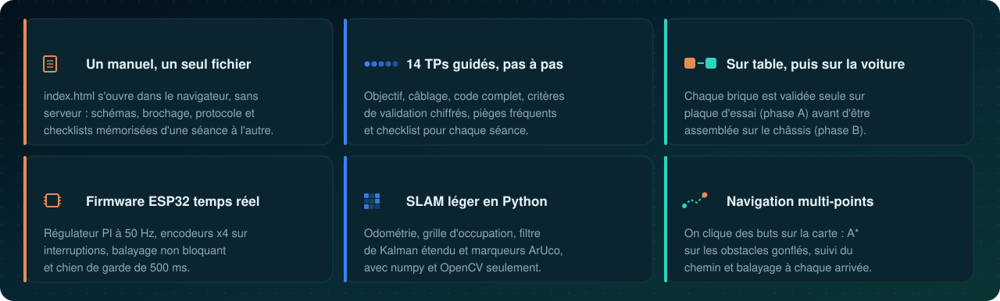
</p>

## Comment ça marche

Le robot répète quatre étapes. Il s'arrête pour balayer, le PC ajoute ce balayage à la carte, la caméra recale la position estimée, puis A\* trace le chemin vers le but suivant.

<p align="center">
  
</p>

<br/>

## Le manuel

Le manuel est en ligne : **https://z-nadjib.github.io/Robot-Cartographe-Slam/**. Il tient aussi dans un seul fichier, **[`index.html`](index.html)**, qu'on peut ouvrir hors ligne dans Chrome, Firefox ou Edge après avoir cloné le dépôt.

Ce qu'il apporte en plus d'un simple document :

- **Avancement mémorisé** : checklists, étapes marquées faites d'un clic sur leur numéro, progression de chaque TP dans la barre latérale et bouton « Reprendre » sur l'accueil.
- **Six simulations interactives** : filtre médian (TP2), radar (TP3), décodeur de messages (Protocole), réglage du PI (TP7), grille d'occupation (TP10) et A* (TP12).
- **Recherche** dans tout le manuel avec <kbd>Ctrl</kbd>+<kbd>K</kbd>, sommaire de page, raccourcis clavier, thèmes clair et sombre, version téléphone.
- **Fiches composants** avec photo, rôle dans le robot et points à connaître.

Le site est publié automatiquement sur GitHub Pages à chaque modification de `index.html` (workflow [`.github/workflows/pages.yml`](.github/workflows/pages.yml)).

<p align="center">
  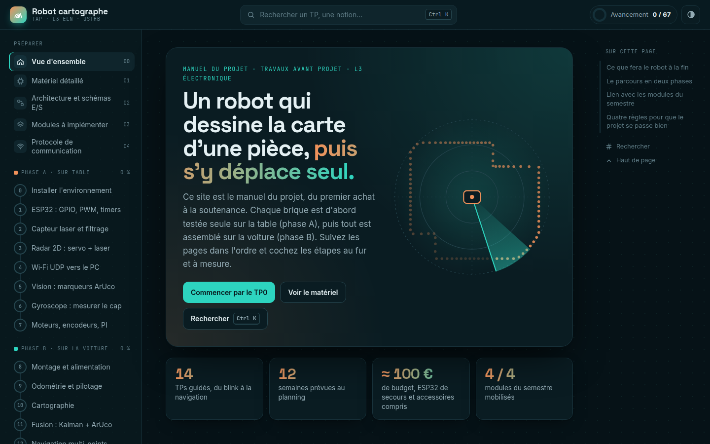
  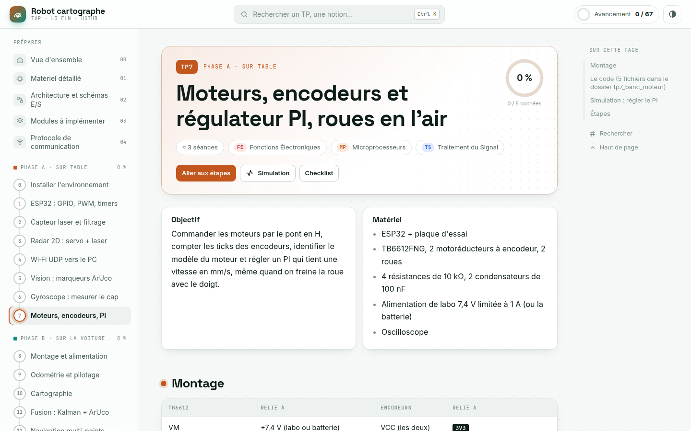
</p>

| Chapitre | Contenu |
|---|---|
| Accueil | Ce que fera le robot, les deux phases, le lien avec les modules du semestre |
| Matériel détaillé | Liste d'achat, fiches techniques, outillage, logiciels |
| Architecture | Vue d'ensemble, entrées et sorties de chaque bloc, brochage, alimentation, budget de courant |
| Modules | Circulation des données, modules du firmware et du PC, ce qui est codé à la main |
| Protocole | Réseau, messages, caméra HTTP, choix techniques à justifier dans le rapport |
| TP 0 à TP 13 | Objectif, matériel, câblage, étapes, squelettes de code à compléter, critères de validation chiffrés, pièges fréquents, checklist |

<br/>

## Le code : des squelettes à compléter

Le dépôt ne donne pas les solutions. Chaque fichier de [`firmware/`](firmware/) et de [`pc/`](pc/) contient :

1. **une description en tête de fichier** : son rôle dans le robot, ce qu'il doit faire étape par étape, les formules, les registres ou les fonctions de bibliothèque utiles, et la façon de le valider ;
2. **les signatures à remplir** : noms de fonctions, paramètres et constantes d'interface (broches, ports, formats de messages) sont fixés pour que les modules s'emboîtent d'un TP à l'autre. Les corps sont marqués « À compléter ».

```cpp
// speed_pi.h (extrait)
struct SpeedPI {
  float integ = 0;
  float update(float consigne, float mesure, float dt) {
    // À compléter.
    return 0;
  }
  void reset() { integ = 0; }
};
```

Les squelettes C++ compilent tels quels, et les modules Python s'importent : on peut avancer fonction par fonction. Une fonction Python pas encore écrite lève `NotImplementedError`. Seuls [`config.h`](firmware/robot_fw/config.h) (broches, géométrie, gains) et [`markers.json`](pc/robot/markers.json) (position des marqueurs) sont complets : ce sont des réglages, pas des exercices.

Le manuel affiche les mêmes squelettes, avec un badge « à compléter » sur chaque bloc concerné.

<br/>

## Installation

### Firmware (Arduino IDE 2)

1. Ajouter les cartes **ESP32 d'Espressif, version 3.x**, et la bibliothèque **VL53L1X de Pololu**.
2. Ouvrir un dossier de [`firmware/tests/`](firmware/tests/), choisir la carte *ESP32 Dev Module* et téléverser.
3. Pour le robot complet, ouvrir [`firmware/robot_fw/`](firmware/robot_fw/), puis renseigner le Wi‑Fi dans [`comms.h`](firmware/robot_fw/comms.h), la géométrie et les gains du PI dans [`config.h`](firmware/robot_fw/config.h).

### PC (Python 3.10 ou plus récent)

```bash
git clone https://github.com/Z-Nadjib/Robot-Cartographe-Slam.git
cd Robot-Cartographe-Slam
python -m venv venv
source venv/bin/activate          # Windows : venv\Scripts\activate
pip install -r pc/requirements.txt
```

Cela installe `numpy`, `matplotlib`, `opencv-contrib-python` (4.7 ou plus, pour ArUco) et `pyserial`.

> [!TIP]
> Le réseau conseillé est le **partage de connexion d'un téléphone en 2,4 GHz**. Le PC, le robot et l'ESP32‑CAM s'y connectent tous les trois.

<br/>

## Utilisation

Les scripts se lancent depuis `pc/robot/`, où ils trouvent `markers.json` et `calib.npz`. L'adresse IP du robot s'affiche sur le moniteur série au démarrage de l'ESP32. Chaque commande ci-dessous fonctionne une fois le fichier correspondant complété.

### Un script par étape

| TP | Commande | Ce que fait le script |
|:---:|---|---|
| 2 | `python ../tools/plot_serial.py /dev/ttyUSB0` | Trace le laser brut et filtré, enregistre un CSV |
| 3 | `python ../tools/radar_serial.py /dev/ttyUSB0` | Affiche le radar reçu sur le port série |
| 4 | `python ../tools/udp_radar.py IP_ROBOT` | Affiche le radar reçu en UDP, compte les pertes, mesure la latence |
| 5 | `python ../tools/calibrate.py http://IP_CAM/capture` | Calibre la caméra sur un damier 9 × 6 et écrit `calib.npz` |
| 5 | `python aruco_cam.py http://IP_CAM/capture` | Détecte les marqueurs, donne leur distance et leur angle |
| 7 | `python ../tools/analyse_echelon.py echelon.csv` | Ajuste un modèle du premier ordre et propose KP et KI |
| 9 | `python teleop.py IP_ROBOT` | Pilotage au clavier (Z Q S D) et tracé de l'odométrie |
| 10 | `python map_live.py IP_ROBOT` | Téléopération et carte en direct, touche **C** pour balayer |
| 11 | `python fusion_test.py IP_ROBOT http://IP_CAM/capture` | Compare l'odométrie seule et l'EKF sur un même trajet |
| 12 | `python app.py IP_ROBOT http://IP_CAM/capture` | Application finale |

### L'application finale

```bash
cd pc/robot
python app.py 192.168.43.50 http://192.168.43.51/capture
```

| Action | Effet |
|---|---|
| Clic gauche sur la carte | Ajoute un but ; les buts sont visités dans l'ordre |
| <kbd>C</kbd> | Lance un balayage |
| <kbd>E</kbd> | Enregistre l'image de la carte |
| <kbd>Échap</kbd> | Arrête le robot et quitte |

À chaque but atteint, le robot s'arrête et balaye avant de repartir. Un but inaccessible est signalé puis ignoré.

<br/>

## Le parcours en 14 TPs

Le projet avance en deux phases. En **phase A**, chaque brique est validée seule sur une plaque d'essai. En **phase B**, tout est assemblé sur la voiture.

Les TPs se font **à la maison** : ni oscilloscope ni alimentation de labo. Un multimètre, le traceur série de l'IDE Arduino et l'ESP32 lui-même servent d'instruments de mesure, et la batterie 2S protégée par un fusible alimente les essais sur table.

<p align="center">
  
</p>

Chaque TP met en pratique un ou plusieurs modules du semestre :

| Module | Dans le projet | TPs |
|---|---|:---:|
| **Fonctions Électroniques** | Pont en H, encodeurs, régulation 5 V, pont diviseur, modèle du moteur | 7, 8 |
| **Traitement du Signal** | Filtre médian, intégration du gyroscope, traitement d'image, filtre de Kalman | 2, 3, 5, 6, 11 |
| **Systèmes Microprocesseurs** | PWM (LEDC), interruptions, timers, I2C, ADC, ordonnancement non bloquant | 1, 3, 7, 9 |
| **Réseaux Informatiques Locaux** | IP, sockets UDP, protocole applicatif, latence et pertes, HTTP, Wireshark | 4, 5, 9 |

<br/>

## Architecture

L'ESP32 ne fait que ce qui exige du **temps réel** : régulation des roues, comptage des encodeurs, intégration du cap et balayage. Tout ce qui demande de la mémoire ou du calcul tourne sur le **PC**. Les deux ne communiquent que par Wi‑Fi.

<p align="center">
  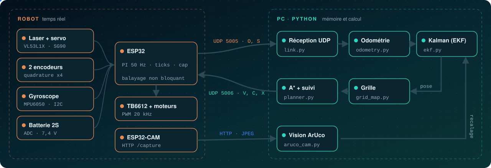
</p>

| | Module | Rôle |
|:---:|---|---|
| ESP32 | [`motors.h`](firmware/robot_fw/motors.h) | Pont en H TB6612, PWM à 20 kHz, commande de −255 à +255 |
| ESP32 | [`encoders.h`](firmware/robot_fw/encoders.h) | Quadrature x4 sur interruptions, table de décodage |
| ESP32 | [`speed_pi.h`](firmware/robot_fw/speed_pi.h) | PI de vitesse par roue, sans intégration en saturation |
| ESP32 | [`imu.h`](firmware/robot_fw/imu.h) | MPU6050 lu en I2C sans bibliothèque, biais mesuré au démarrage |
| ESP32 | [`scanner.h`](firmware/robot_fw/scanner.h) | Machine à états servo + laser, 61 mesures sur 180° |
| ESP32 | [`comms.h`](firmware/robot_fw/comms.h) | Wi‑Fi et UDP texte, chien de garde de 500 ms |
| PC | [`odometry.py`](pc/robot/odometry.py) | Pose (x, y, θ) à partir des ticks et du cap du gyroscope |
| PC | [`grid_map.py`](pc/robot/grid_map.py) | Grille log-odds de 6 × 6 m en cases de 5 cm, rayons tracés par Bresenham |
| PC | [`aruco_cam.py`](pc/robot/aruco_cam.py) | Détection ArUco et `solvePnP`, d'où la distance et l'angle du marqueur |
| PC | [`ekf.py`](pc/robot/ekf.py) | Filtre de Kalman étendu, test du χ² contre les mesures aberrantes |
| PC | [`planner.py`](pc/robot/planner.py) | Obstacles gonflés, puis recherche A* sur 8 voisins |
| PC | [`controller.py`](pc/robot/controller.py) | Suivi de point : s'orienter vers la cible, puis avancer |

<details>
<summary><b>Brochage de l'ESP32</b></summary>
<br/>

| GPIO | Fonction | Relié à |
|:---:|---|---|
| `21` / `22` | SDA / SCL (I2C) | VL53L1X (0x29), MPU6050 (0x68) |
| `13` | PWM 50 Hz | Servo SG90 |
| `25` `26` `27` | PWMA, AIN1, AIN2 | TB6612, moteur gauche |
| `18` `16` `17` | PWMB, BIN1, BIN2 | TB6612, moteur droit |
| `23` | STBY | TB6612 |
| `34` `35` / `36` `39` | Encodeurs A, B | Encodeurs gauche / droit (tirage de 10 kΩ vers 3,3 V) |
| `33` | ADC1 | Pont diviseur 100 kΩ / 33 kΩ de la batterie |
| `2` | LED | LED d'état externe, 220 Ω vers GND (la DevKitC V4 n'a pas de LED utilisateur) |

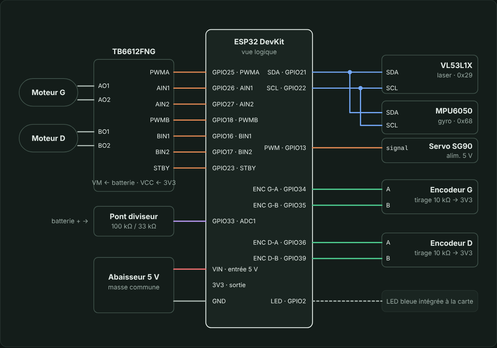
</details>

<br/>

## Protocole

Chaque message est une ligne de texte envoyée dans un seul datagramme UDP. Les champs sont séparés par des virgules.

| Sens | Message | Rôle |
|---|---|---|
| Robot → PC (5005) | `O,seq,t_ms,ticksG,ticksD,cap_mdeg,avant_mm,vbat_mV` | Télémesure à 20 Hz |
| Robot → PC (5005) | `S,seq,angle0,pas,d0,…,d60` | Un balayage de 61 distances en mm |
| PC → robot (5006) | `V,v_mm_s,w_mrad_s` | Consigne de vitesse, à répéter |
| PC → robot (5006) | `C` · `X` · `M,pwmG,pwmD` · `P,…` | Balayer · arrêter · commande directe · écho |
| Caméra → PC (HTTP) | `GET /capture` | Une image JPEG |

> [!IMPORTANT]
> Le robot s'arrête de lui-même dans deux cas : s'il ne reçoit plus de consigne pendant 500 ms, ou si un obstacle se trouve à moins de 150 mm devant lui.

<br/>

## Matériel

<table>
  <tr>
    <td align="center" width="25%">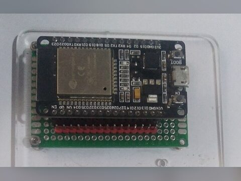<br/><b>ESP32‑DevKitC V4 (32E)</b><br/><sub>Cerveau du robot, Wi‑Fi</sub></td>
    <td align="center" width="25%">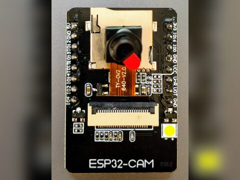<br/><b>ESP32‑CAM</b><br/><sub>Images pour les marqueurs ArUco</sub></td>
    <td align="center" width="25%">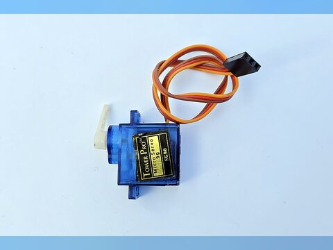<br/><b>Servo SG90</b><br/><sub>Balayage du laser sur 180°</sub></td>
    <td align="center" width="25%">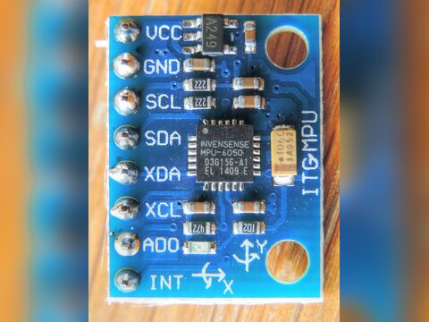<br/><b>MPU6050 (GY‑521)</b><br/><sub>Gyroscope, mesure du cap</sub></td>
  </tr>
  <tr>
    <td align="center">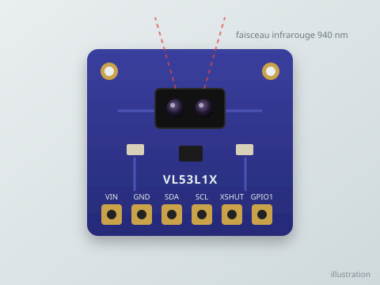<br/><b>VL53L1X</b><br/><sub>Laser : distance jusqu'à 4 m</sub></td>
    <td align="center">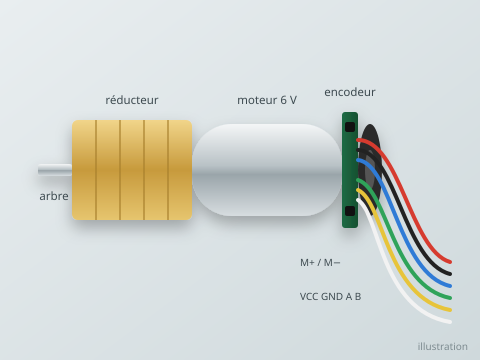<br/><b>Motoréducteur à encodeur</b><br/><sub>Propulsion et odométrie</sub></td>
    <td align="center">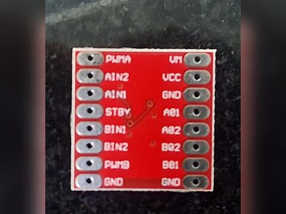<br/><b>TB6612FNG</b><br/><sub>Pont en H double</sub></td>
    <td align="center">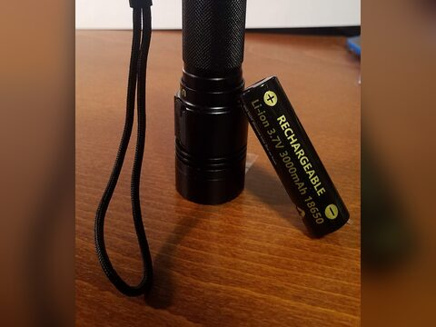<br/><b>2 accus 18650</b><br/><sub>Alimentation 2S, 7,4 V</sub></td>
  </tr>
  <tr>
    <td align="center">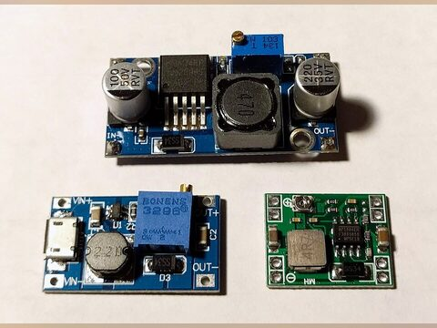<br/><b>Abaisseur DC‑DC</b><br/><sub>5 V / 3 A pour l'électronique</sub></td>
    <td align="center">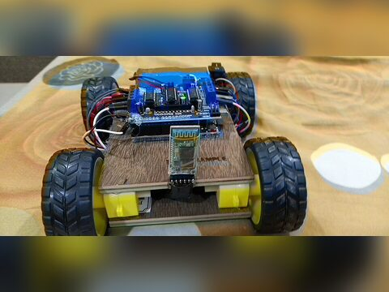<br/><b>Châssis 2 roues</b><br/><sub>Base mobile et roue folle</sub></td>
  </tr>
</table>

<sub>Photos issues de Wikimedia Commons, sous licences CC BY-SA et CC0 ; le VL53L1X et le motoréducteur sont des illustrations. Auteurs et licences : [`docs/assets/materiel/CREDITS.md`](docs/assets/materiel/CREDITS.md). Le manuel détaille le rôle de chaque composant dans sa page *Matériel détaillé*.</sub>

| Composant | Quantité | Rôle |
|---|:---:|---|
| ESP32‑DevKitC V4, version 32E (module WROOM‑32E) | 2 | Cerveau du robot ; la seconde sert de secours |
| Capteur laser VL53L1X | 1 | Distances jusqu'à 4 m |
| Servo SG90 ou MG90S | 1 | Balayage sur 180° |
| ESP32‑CAM AI‑Thinker + carte ESP32‑CAM‑MB | 1 | Images pour les marqueurs ArUco |
| MPU6050 (GY‑521) | 1 | Vitesse de rotation, donc le cap |
| TB6612FNG | 1 | Pont en H double |
| Motoréducteur **avec encodeur Hall**, au format TT de préférence | 2 | Propulsion et odométrie |
| Kit châssis 2 roues : plaque, roues, roue folle | 1 | Base mobile (ses moteurs TT d'origine n'ont pas d'encodeur) |
| Accu 18650 | 2 | Alimentation 2S, 7,4 V |
| Support 2S + chargeur | 1 | Logement et recharge des accus |
| Abaisseur DC‑DC 5 V / 3 A, fusible, interrupteur | 1 | Distribution de l'énergie |

> [!WARNING]
> Les kits châssis 2 roues sont presque toujours livrés avec deux moteurs TT jaunes **sans encodeur**. Ils ne permettent ni la régulation de vitesse ni l'odométrie : on garde la plaque, les roues et la roue folle, et on achète à part deux moteurs **TT avec encodeur Hall**, qui se montent à la place.

Le budget est d'**environ 100 €**, ESP32 de secours et accessoires compris. Le chapitre *Matériel détaillé* du manuel indique ce qu'il faut vérifier avant chaque achat.

<br/>

## Structure du projet

```
Robot-Cartographe-Slam
|-- index.html              le manuel complet, à ouvrir dans un navigateur
|-- firmware                squelettes à compléter
|   |-- tests               un croquis Arduino par TP de la phase A
|   `-- robot_fw            firmware final du robot (TP9 à TP13)
|-- pc                      squelettes à compléter
|   |-- requirements.txt
|   |-- tools               tracés, calibration, marqueurs, analyse de l'échelon
|   `-- robot               odométrie, carte, EKF, A*, application
|-- mesures                 courbes, CSV et photos pour le rapport
`-- docs
    |-- captures            captures d'écran du manuel
    `-- assets              figures de cette page, photos du matériel
```

Les figures de cette page sont générées par [`docs/assets/make_figures.py`](docs/assets/make_figures.py).

<br/>

## État du projet

- [x] Manuel complet : matériel, schémas, modules, protocole, 14 TPs
- [x] Squelettes du code ESP32 et Python de tous les TPs
- [x] Manuel interactif publié sur GitHub Pages
- [ ] Code complété
- [ ] Phase A validée sur table
- [ ] Robot assemblé (phase B)
- [ ] Carte, fusion et navigation validées
- [ ] Rapport et soutenance

> [!NOTE]
> Le code est fourni sous forme de squelettes : les descriptions disent quoi écrire, les critères de validation de chaque TP disent quand c'est réussi. Rien n'a encore tourné sur le vrai matériel ; des ajustements (calibrations, gains, sens des moteurs) sont à prévoir pendant les TPs.

## Encadrement

Projet conçu et encadré par **Zahaf Boualem Nadjib**, pour un groupe d'étudiants de Licence 3 Électronique de l'Université des Sciences et de la Technologie Houari Boumediene (USTHB). Le manuel, les squelettes de code et le matériel de ce dépôt servent de support au groupe tout au long du projet.

<div align="center">
<br/>

</div>
